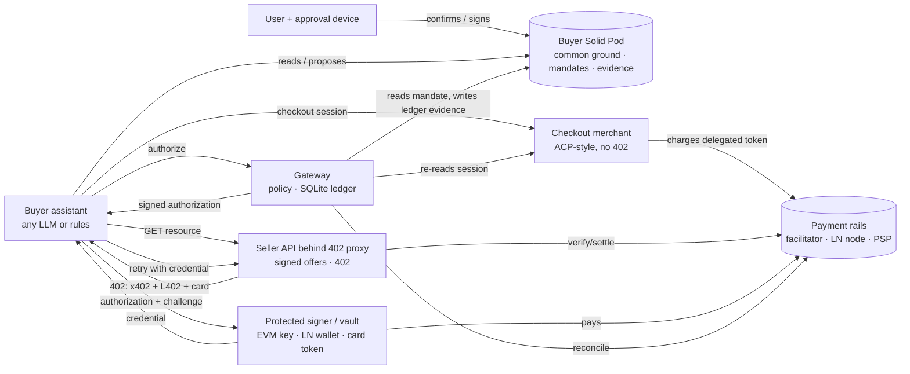

# Solid Commerce

A working prototype of grounded AI shopping:

- **Solid Pods** hold what the user wants: agreed meanings, preferences, requirements and explicit spending mandates. All are user-controlled and versioned.
- **Approved sellers** publish signed offers. A reusable **402 proxy** lets any existing HTTP API sell through HTTP 402 without code changes.
- **HTTP 402** is the payment decision point. One 402 response can offer several payment protocols.
- Shops that will never speak 402 (physical goods) are reached through an **ACP-style checkout adapter**. The same gateway and signer stay the only authority.
- A deterministic **gateway** reserves budget and authorises each payment, and a separate **signer** holds the keys.
- The interpreter runs on **any major LLM provider** (Claude, OpenAI, Gemini, Ollama, OpenAI-compatible endpoints) or offline rules.
- Every step leaves **evidence** in the Pod, and a **web demo** shows it all live.

> **Status: prototype. All payments are simulated.** Signatures are real (EIP-712, Ed25519), protocols run over real HTTP, and the Pod is a real Community Solid Server. Settlement happens in in-memory simulations of the payment rails. Do not use with real funds.

## Is HTTP 402 tied to x402?

No. RFC 9110 reserves `402 Payment Required` but gives it no semantics. The status code is only the decision point; the payment exchange is defined by whichever protocol the server offers. This prototype serves **three protocols from the same 402 response**, and the gateway and signer handle all of them the same way:

| Scheme | 402 challenge | Retry credential | Settles via | Status here |
|---|---|---|---|---|
| **x402 v2** (`exact`, EIP-3009) | `PAYMENT-REQUIRED: base64(JSON)` | `PAYMENT-SIGNATURE: base64(JSON)` → `PAYMENT-RESPONSE` | facilitator `/verify` + `/settle` (stablecoin) | Wire format checked against `@x402/core` 2.31. Real EIP-712 signatures; simulated facilitator and token ledger |
| **L402-style** | `WWW-Authenticate: L402 macaroon="…", invoice="…"` | `Authorization: L402 <macaroon>:<preimage>` | Lightning-style invoice, preimage = proof | Simplified HMAC "macaroon" and a simulated node. Not BOLT11, not libmacaroons |
| **Card / PSP intent** | `WWW-Authenticate: Payment method="card-psp", id="pi_…", …` | `Authorization: Payment <base64url>` | PSP payment intent, confirmed by the vault with a card token | Loosely modelled on the "Payment" HTTP auth scheme of recent machine-payment proposals. Not a spec implementation |

The same pattern carries over to bank payment initiation: the 402 names a provider-side payment object, the buyer's vault completes it, and the seller checks it with the provider. To add a scheme, add a parser in `src/payments/http402.ts`, a payer in `src/signer`, a verifier in `src/payments/serverSide.ts` (used by the proxy), and a reconciler in the gateway.

And when the seller has no 402 at all, the buyer side can synthesize the same decision point from the seller's checkout API (see [Physical goods](#physical-goods-acp-style-checkout)). The gateway and signer do not depend on the status code. They need a payment request bound to terms they can check.

## Run it

Requires Node.js ≥ 22.13 on the 22.x line, or ≥ 23.4. Ledger storage uses the built-in `node:sqlite`, and those are the first releases that load it without the `--experimental-sqlite` flag (no script passes that flag). CI runs on 22.13.0 and on the latest 22.x.

```bash
npm install
```

```bash
npm run demo
```

```bash
npm run demo:interactive
```

```bash
npm run demo:web
```

```bash
npm test
```

- `npm run demo` runs the full Berlin weather scenario in the terminal with auto-answers.
- `npm run demo:interactive` lets you answer the clarification and approve on the "device".
- `npm run demo:web` starts the web demo: live dashboard, phone approval by QR code, "Break it" and the shoes checkout (see [Web demo](#web-demo)).
- `npm test` runs the unit, end-to-end, proxy, checkout, LLM-provider and web-demo suites. The end-to-end suites start a real Community Solid Server.

Options:

- `LLM_PROVIDER=anthropic|openai|gemini|ollama|openai-compatible` (with `LLM_MODEL`, and the provider's usual API-key variable) runs the interpreter on an LLM instead of the offline rules. See [`docs/llm-providers.md`](docs/llm-providers.md). The older `INTERPRETER=claude` still works.
- `POD_URL=http://localhost:3000/ npm run demo` uses an already running Solid server (`npm run pod` starts one).
- `npm run demo -- --export-examples ontology/examples` writes the generated Pod documents to disk.
- `npm run proxy -- --config proxy.example.json` runs the 402 proxy in front of an API of your own. It needs payment rails: `npm run rails` starts the simulated ones (see [the proxy section](#selling-through-http-402-the-proxy)).
- `npm run compare:interpreters` runs the same requests through every configured LLM provider and reports where they differ.

### What the demo shows

1. *"Get me a current Berlin weather report. I prefer providers that include an hourly forecast. You may spend up to 1 USDC from approved providers."*
2. The assistant asks what **"current"** means (15 / 60 / 180 minutes). The answer becomes an **agreed meaning** plus a **requirement** grounded in it.
3. The user approves four separate records on the approval device. The spending mandate is shown as **FINANCIAL AUTHORITY**, apart from the preferences.
4. Three offers are compared:
   - Spree Weather: acceptable.
   - Havel Data: data up to 90 min old, which fails the agreed meaning.
   - Shady Forecasts: cheapest, but not an approved seller.
5. The purchase runs: `402` → gateway reserves 0.02 USDC → signer signs an EIP-3009 authorization → retry → `200`, with a seller-signed receipt and a delivery check against "current".
6. A **fresh session**, and then a **different agent**, read the same common ground and are not asked again. The other agent cannot spend: it is not an assignee of the mandate.
7. Guardrails:
   - A mandate edited in the Pod to 100 USDC is rejected by the assistant and by the gateway, because the user's signature no longer matches.
   - A price change between evaluation and payment forces re-validation.
8. The same endpoint is paid via **L402-style** and **card** once mandates in SAT and EUR are approved.

## Architecture



| Component | Path | Responsibility |
|---|---|---|
| Ontology | `ontology/sc.ttl`, `ontology/shapes.ttl` | Small application profile reusing ODRL, SKOS, PROV-O, schema.org, QUDT; SHACL shapes |
| RDF mapping | `src/rdf/records.ts`, `src/rdf/evidence.ts` | Deterministic record ↔ Turtle; evidence documents |
| Pod | `src/pod/` | Solid LDP client, Pod layout, WAC policy, wallet descriptor (no secrets) |
| Grounding | `src/grounding/` | Rule-based and LLM interpreters, validation, clarification, revisions, user confirmation |
| LLM providers | `src/llm/` | Provider-neutral structured generation: Anthropic, OpenAI/Azure, Gemini/Vertex, Ollama, OpenAI-compatible; local schema validation and one repair attempt |
| Assistant | `src/agent/` | Offer ranking, 402 flow, checkout purchases, delivery checks, order tracking, recovery |
| Trust | `src/trust/registry.ts` | Approved sellers bound to pinned offer-signing keys; approved checkout merchants bound to pinned API addresses |
| 402 proxy | `src/proxy/`, `src/payments/serverSide.ts` | Sells any upstream API through HTTP 402: identity, signed offers, multi-scheme challenges, settlement, route binding, signed receipts |
| Seller | `src/seller/sellerServer.ts` | Demo weather sellers: a plain API with the 402 proxy in front |
| Checkout | `src/checkout/`, `src/agent/checkoutPurchase.ts` | ACP-style checkout adapter for physical goods: feed → candidates, session, delegated payment, tracking |
| Gateway | `src/gateway/` | Mandate verification, offer/challenge or checkout-snapshot binding, atomic budget reservation, idempotency, reconciliation |
| Signer | `src/signer/` | Pays only against gateway-signed authorizations, idempotently; mints one-time delegated card tokens |
| Payment schemes | `src/payments/` | x402, L402-style and card/PSP parsers and payers, plus simulated rails, PSP and checkout merchants |
| Web demo | `src/web/` | Live dashboard, wire trace, phone approval, Break it, shoes checkout, recording and replay |

**Who may call the gateway and the signer** (`src/trust/agentAuth.ts`). Each agent gets its own random bearer secret at setup (`startEnvironment` issues them; they stay in memory and are never written to the Pod). The gateway and the signer store only a SHA-256 of each secret. The acting agent is the one whose secret is presented; a request body whose `agentId` names another agent is refused with `AGENT_MISMATCH`. Every gateway route except `GET /budget` needs a secret, otherwise `401 AGENT_NOT_AUTHENTICATED`. `GET /transactions/:id` answers only the transaction's own agent (`NOT_YOUR_TRANSACTION`) or the operator. The operator (admin) secret is accepted only there and on `POST /reconcile`; it cannot authorize or pay. In the web demo, the Break-it scenarios use it to read a transaction. The signer hands out a credential, new or replayed, only to the agent the authorization names. `GET /budget` stays unauthenticated and shows the limit, committed, settled and available amounts of a mandate.

See [`docs/design.md`](docs/design.md) for the design decisions and threat model.

## Ontology: representing what the user wants

Natural language is never stored as authority. The interpreter proposes a structured interpretation. The application validates it against a fixed vocabulary, asks about ambiguous terms, and has the user confirm. Then it generates the RDF deterministically and checks it with SHACL before writing.

| Statement | Record | Effect |
|---|---|---|
| "I prefer providers with an hourly forecast" | `sc:Preference` (+ weight) | Ranking only. SHACL forbids it from carrying `odrl:permission` |
| "Current means observed within 60 minutes" | `sc:AgreedMeaning` ⊑ `skos:Concept`, `sc:operationalizedAs` a criterion | Grounds later interpretation; versioned, reused across sessions and agents |
| "The report must be current" | `sc:PurchaseRequirement`, `sc:groundedIn` the meaning | Filters offers. Missing information counts as *not met* |
| "You may spend up to 1 USDC from approved providers" | `sc:SpendingMandate` ⊑ `odrl:Set` with `odrl:payAmount`, `sc:totalSpend`, `odrl:dateTime`, `sc:seller`, `sc:paymentScheme` constraints | The only thing the gateway accepts as financial authority |

Every record carries `sc:revision`, `sc:status` (`Proposed` / `UserConfirmed` / `Rejected` / `Superseded`), provenance (`prov:wasDerivedFrom` the original statement, `prov:wasRevisionOf` the archived previous revision) and an `sc:Confirmation`. The confirmation is an Ed25519 signature by the user's enrolled approval key over the canonical digest of the record's terms. RDF syntax alone cannot establish consent; the signature and the enrolled key do. Editing any confirmed term in the Pod invalidates it. Putting an older signed revision back in place of a newer one is refused too: the assistant compares each live record with the signed copies archived in `history/`, and the gateway remembers the newest mandate revision it has verified (`MANDATE_SUPERSEDED`). An agent that also deletes the history documents defeats the assistant's check; see the [threat table](docs/design.md#threats-considered).

Real generated examples are in [`ontology/examples/`](ontology/examples/). The `sc:` namespace (`https://w3id.org/solid-commerce#`) is a placeholder and not a registered standard.

## Selling through HTTP 402: the proxy

A real seller does not need to rewrite its API. `src/proxy/` is a reverse proxy, similar in spirit to Aperture for L402, that sits in front of any HTTP API:

- It publishes the seller's identity (`/profile/card`, with the offer-signing key) and one signed, versioned offer per paid route.
- An unpaid request to a paid route gets one 402 with x402, L402-style and card challenges. A paid request is settled first, then forwarded upstream with all payment headers stripped. The response carries a seller-signed receipt over the exact bytes returned.
- Each payment is bound to one resource and one request target. A credential bought for one route never opens another. Re-presenting a settled credential re-delivers a GET without charging again; for other methods a delivered payment is used up.
- Route matching is canonical. Respellings of a paid path, other methods on it and ambiguous escapes are refused (404 / 405 / 400), never passed through for free.
- A paid route with a method other than GET needs an `Idempotency-Key` header on the paid request. Without one, a request that carries a payment credential gets `400 idempotency_key_required` before any money moves, and the 402 says the key is required. The payment then serves that one request (key plus a digest of target, content type and body): an identical retry is forwarded again after an upstream failure or refusal, or answered from the stored response once delivered (`sc-idempotent-replay: true`). Any other request gets `409 idempotency_conflict` before delivery and `402 credential_consumed` after it.
- If the upstream fails after payment, the buyer gets `502` with `paid: true` and can retry with the same credential (for a non-GET route: the same request with the same `Idempotency-Key`).

The proxy needs payment rails that speak the HTTP surfaces of `src/payments/sim/`, and in this prototype only the simulations do. To try it with `proxy.example.json`, use two terminals:

```bash
# Terminal 1: simulated x402 facilitator, Lightning node and PSP on the config's rails ports
# (127.0.0.1:4021-4023), plus a stand-in API on its upstream address (127.0.0.1:9000)
npm run rails -- --example-upstream
```

```bash
# Terminal 2: the proxy on 127.0.0.1:8402, then one unpaid and one paid request
npm run proxy -- --config proxy.example.json &
sleep 5                                                       # wait until the proxy prints its route table
curl -i http://127.0.0.1:8402/v1/aqi/current                  # 402: x402, L402 and card challenges
npm run rails -- pay http://127.0.0.1:8402/v1/aqi/current     # pays 8 SAT over L402: HTTP 200 with an sc-receipt
kill %1                                                       # stops the proxy
```

`npm run rails -- pay <url>` is a minimal L402 buyer for trying the seller side by hand. It credits a throwaway account on the simulated Lightning node (a faucet only the simulation has), pays whatever the 402 asks and repeats the request with the credential (with `--method POST` for a paid POST route, plus an `Idempotency-Key`). It bypasses the gateway, mandates and signer that the assistant uses. All rails state is in memory and is lost when `npm run rails` stops. Without `--example-upstream`, put your own API on the config's `upstream` address. `test/llm.test.ts` runs the same three commands with the real CLIs, on free ports.

Keys come only from environment variables or files named in the config, never from the config itself. Missing keys are generated for the process with a loud warning. The demo weather sellers are themselves plain APIs behind this proxy.

## Physical goods: ACP-style checkout

Most shops will never answer with 402. For them the assistant uses an ACP-style checkout API (checkout sessions, totals including delivery and tax, delegated payment). It is modelled on the public description of the Agentic Commerce Protocol and has not been checked against the specification.

1. **Compare** products from approved merchants' feeds with the same ranking, requirements and preferences as 402 offers. Example: "repairable shoes" is clarified to *replaceable soles*, and the price compared is item plus delivery.
2. **Check out** with the chosen merchant only. The Pod's shipping address (`schema:PostalAddress`) goes to that one merchant.
3. **Authorize:** the gateway re-reads the checkout session itself from the merchant's pinned API address. It does not trust the agent's numbers. It checks total (including delivery) against the mandate, line items, category, payee and shipping address, then binds the authorization to a digest of that snapshot. Only one live authorization per checkout session is allowed.
4. **Pay:** the signer has the PSP mint a one-time delegated card token limited to that amount, merchant, session, snapshot and expiry. The card token never leaves the signer.
5. **Track:** the order moves through shipped → delivered. Then the user signs a verdict on the approval device ("Can the soles be replaced?"), which is recorded as the delivery outcome. Cancellation and refunds release budget only when the PSP confirms them.

## LLM providers

The interpreter can run on Anthropic Claude, OpenAI or Azure OpenAI, Google Gemini or Vertex AI, Ollama, or any OpenAI-compatible endpoint (Mistral, Groq, OpenRouter, Together, DeepSeek, LM Studio, vLLM). Claude on Amazon Bedrock or Google Vertex AI is not wired: no `LLM_PROVIDER` value selects it, and its SDK clients (`@anthropic-ai/bedrock-sdk`, `@anthropic-ai/vertex-sdk`) are not dependencies. Such a client can be passed to the Anthropic adapter in code; that path is untested. Each adapter uses the provider's native structured-output mode and then validates the answer locally, with one repair attempt. An adapter created from configuration (`createLlm`, `LLM_PROVIDER`) refuses to send an API key or token over plain `http://` to a host other than loopback.

Whatever the model says still passes the vocabulary check, clarification and the user's signature. A weaker model can misread a request, but it cannot create spending authority. Setup per provider: [`docs/llm-providers.md`](docs/llm-providers.md).

> The adapters are tested against local servers that mimic each provider's wire format. None of them has been run against the live services in this repository's tests.

## Web demo

```bash
npm run demo:web
```

It prints a dashboard URL, a phone URL and a QR code:

| Screen | What it shows |
|---|---|
| Live dashboard | The conversation, offers with reasons, every real HTTP exchange of the 402 flow ("on the wire"), the Pod's documents, Turtle and budget |
| Phone approval | Opened from the QR code. Each item is approved on the phone; spending mandates are shown separately as FINANCIAL AUTHORITY |
| Break it | Six live attacks and failures with the gateway's real verdicts |
| Shoes | The checkout flow for physical goods, tracking and the user's signed verdict |

A research/business toggle switches between mechanism detail and outcomes. Live calls are the default; `npm run demo:web -- --rehearse talk` records a verified fallback, and `--replay recordings/talk.json` plays it back. Presenter guide: [`docs/demo.md`](docs/demo.md).

## Completion checks

All checks from the implementation brief are automated in `test/e2e.test.ts`. The proxy, checkout, LLM-provider and web-demo suites (`test/proxy.test.ts`, `test/checkout.test.ts`, `test/llm.test.ts`, `test/web.test.ts`) cover the same properties for their parts, including a regression test for every confirmed review finding.

| Check | Test |
|---|---|
| An allowed purchase succeeds and produces linked evidence | `an allowed purchase succeeds…` |
| Overspending and unapproved sellers are blocked: budget, per-purchase limit, seller not in mandate, seller not approved, offer re-signed with another key | `overspending and unapproved sellers…` |
| Changed offers require revalidation, at the gateway and in the assistant | `changed offers require revalidation` |
| Concurrent requests cannot exceed the budget: 6 parallel purchases by 2 agents against 0.05 USDC → exactly 2 settle | `concurrent requests…` |
| Retries and replay cause no duplicate charges: gateway idempotency, signer coalescing, seller re-delivery, cross-seller replay, payee substitution, forged authorizations | `retries and replay…` |
| Ambiguous requirements trigger clarification | `ambiguous requirements…` |
| Confirmed meanings persist into a new session and another agent; revisions are archived | `confirmed meanings persist…` |
| Preference changes cannot silently expand spending: confirmed preference changes, tampered mandates, rejected proposals | `preference changes cannot…` |
| Payment and delivery failures stay distinguishable and recoverable: paid-not-delivered → recovered without paying again; settlement response lost; non-compliant delivery; failed payment → held, then released after reconciliation | `payment and delivery failures…` |

## What is real and what is simulated

| Real | Simulated / simplified |
|---|---|
| Solid Protocol over HTTP against Community Solid Server 7 | CSS runs with its open development config (no Solid-OIDC). WAC documents are generated (`buildAcls`) but not applied |
| x402 v2 headers and payload shapes; EIP-712 `TransferWithAuthorization` signatures (viem) | Facilitator and USDC ledger are in-memory. Network IDs point at Base Sepolia but nothing touches a chain |
| Ed25519 signatures on offers, receipts, authorizations and user confirmations | User approval device is in-process (stands in for a passkey or phone) |
| SQLite ledger with `BEGIN IMMEDIATE` reservations and a per-mandate revision high-water mark | The ledger runs in memory (`:memory:`) in every entry point (`npm run demo`, `npm run demo:web` and the tests): a restart forgets all budget state and revision marks. `ledgerPath` accepts a file, but no entry point sets it and no test runs several processes on one file. Signer idempotency state is in memory |
| Per-agent secrets for the gateway and signer (only SHA-256 hashes stored) | Bearer secrets over plain loopback HTTP, issued at startup, with no rotation, expiry or revocation. A deployment would use mTLS or per-request signatures over TLS |
| SHACL validation (`rdf-validate-shacl`) | Signing uses canonical JSON of parsed terms, not RDF Dataset Canonicalization (RDFC-1.0) |
| 402 proxy over real HTTP | Proxy settlement state (route bindings, Idempotency-Key bindings, stored responses) is in memory: after a proxy restart a consumed non-GET credential can deliver one more request. `npm run rails` serves the simulated rails for it |
| ACP-style checkout sessions, delegated tokens and orders over real HTTP | Merchants and PSP are simulations; ACP shapes are modelled on the public description, not verified against the specification |
| Official provider SDKs (`@anthropic-ai/sdk`, `openai`, `@google/genai`) and Ollama's REST API | Adapters tested only against local mock servers, never against the live services |
| | L402 macaroon and invoices are simplified; the card PSP is a mock |

## Making it real (next steps)

1. **x402 on Base Sepolia:** point the seller at a real facilitator, give the signer a funded test key, and implement `authorization-state` reconciliation through an RPC call to the USDC contract.
2. **Solid authentication:** give the assistant and gateway their own WebIDs. Use client-credentials Solid-OIDC (e.g. `@inrupt/solid-client-authn-node`), pass the authenticated `fetch` to `PodClient`, and apply `buildAcls()`.
3. **L402:** replace the simulated node with LND/CLN and use real macaroons (e.g. Aperture).
4. **Card:** use a PSP's test mode. The vault stores only the PSP's payment-method token.
5. **Signer hardening:** persistent idempotency store, HSM/KMS or a passkey-protected key, rate limits.
6. **Agent authentication:** replace the bearer secrets with mTLS or per-request signatures (e.g. HTTP Message Signatures) over TLS, with rotation and revocation. Give the gateway a ledger file (`ledgerPath`) so budgets and revision marks survive a restart, and test several gateway processes on one file.
7. **Interpretation research:** run `npm run compare:interpreters` against live providers and compare the rule-based and LLM interpreters on intent preservation across sessions and changing preferences (see Frohn, *From Prompting to Grounding*).
8. **Checkout:** verify the ACP-style shapes against the current Agentic Commerce Protocol specification and a real PSP's delegated-payment API; persist the proxy's settlement bindings.

Before using live funds, review the applicable privacy and payment obligations and the operational recovery procedures.

## License

[PolyForm Noncommercial 1.0.0](LICENSE.md). You may use, modify and share this software for **non-commercial purposes**: personal, research, education, and public or charitable organisations. Commercial use requires a separate licence from the copyright holder. Because it restricts commercial use, this is a *source-available* licence, not an OSI-approved open-source licence.
