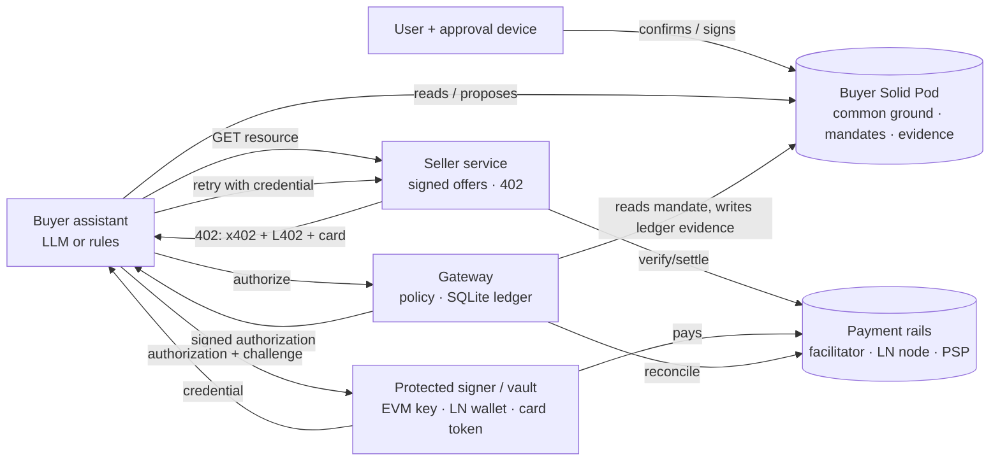

# Solid Commerce

A working prototype of grounded AI shopping:

- **Solid Pods** hold what the user wants: agreed meanings, preferences, requirements and explicit spending mandates. All are user-controlled and versioned.
- **Approved sellers** publish signed offers.
- **HTTP 402** is the payment decision point. One 402 response can offer several payment protocols.
- A deterministic **gateway** reserves budget and authorises each payment, and a separate **signer** holds the keys.
- Every step leaves **evidence** in the Pod.

> **Status: prototype. All payments are simulated.** Signatures are real (EIP-712, Ed25519), protocols run over real HTTP, and the Pod is a real Community Solid Server. Settlement happens in in-memory simulations of the payment rails. Do not use with real funds.

## Is HTTP 402 tied to x402?

No. RFC 9110 reserves `402 Payment Required` but gives it no semantics. The status code is only the decision point; the payment exchange is defined by whichever protocol the server offers. This prototype serves **three protocols from the same 402 response**, and the gateway and signer handle all of them the same way:

| Scheme | 402 challenge | Retry credential | Settles via | Status here |
|---|---|---|---|---|
| **x402 v2** (`exact`, EIP-3009) | `PAYMENT-REQUIRED: base64(JSON)` | `PAYMENT-SIGNATURE: base64(JSON)` → `PAYMENT-RESPONSE` | facilitator `/verify` + `/settle` (stablecoin) | Wire format checked against `@x402/core` 2.31. Real EIP-712 signatures; simulated facilitator and token ledger |
| **L402-style** | `WWW-Authenticate: L402 macaroon="…", invoice="…"` | `Authorization: L402 <macaroon>:<preimage>` | Lightning-style invoice, preimage = proof | Simplified HMAC "macaroon" and a simulated node. Not BOLT11, not libmacaroons |
| **Card / PSP intent** | `WWW-Authenticate: Payment method="card-psp", id="pi_…", …` | `Authorization: Payment <base64url>` | PSP payment intent, confirmed by the vault with a card token | Loosely modelled on the "Payment" HTTP auth scheme of recent machine-payment proposals. Not a spec implementation |

The same pattern carries over to bank payment initiation or ACP-style delegated checkout: the 402 names a provider-side payment object, the buyer's vault completes it, and the seller checks it with the provider. To add a scheme, add a parser in `src/payments/http402.ts`, a payer in `src/signer`, a verifier in the seller, and a reconciler in the gateway.

## Run it

Requires Node.js ≥ 22.5. Ledger storage uses the built-in `node:sqlite`.

```bash
npm install
```

```bash
npm run demo
```

```bash
npm run demo:interactive
```

```bash
npm test
```

- `npm run demo` runs the full Berlin weather scenario with auto-answers.
- `npm run demo:interactive` lets you answer the clarification and approve on the "device".
- `npm test` runs 12 unit tests and 11 end-to-end tests. The end-to-end tests start a real Community Solid Server.

Options:

- `INTERPRETER=claude npm run demo` uses Claude instead of the offline rule-based interpreter. It needs Anthropic credentials (`ANTHROPIC_API_KEY` or an `ant auth login` profile). Set `CLAUDE_MODEL` to change the model.
- `POD_URL=http://localhost:3000/ npm run demo` uses an already running Solid server (`npm run pod` starts one).
- `npm run demo -- --export-examples ontology/examples` writes the generated Pod documents to disk.

### What the demo shows

1. *"Get me a current Berlin weather report. I prefer providers that include an hourly forecast. You may spend up to 1 USDC from approved providers."*
2. The assistant asks what **"current"** means (15 / 60 / 180 minutes). The answer becomes an **agreed meaning** plus a **requirement** grounded in it.
3. The user approves four separate records on the approval device. The spending mandate is shown as **FINANCIAL AUTHORITY**, apart from the preferences.
4. Three offers are compared:
   - Spree Weather: acceptable.
   - Havel Data: data up to 90 min old, which fails the agreed meaning.
   - Shady Forecasts: cheapest, but not an approved seller.
5. The purchase runs: `402` → gateway reserves 0.02 USDC → signer signs an EIP-3009 authorization → retry → `200`, with a seller-signed receipt and a delivery check against "current".
6. A **fresh session**, and then a **different agent**, read the same common ground and are not asked again. The other agent cannot spend: it is not an assignee of the mandate.
7. Guardrails:
   - A mandate edited in the Pod to 100 USDC is rejected by the assistant and by the gateway, because the user's signature no longer matches.
   - A price change between evaluation and payment forces re-validation.
8. The same endpoint is paid via **L402-style** and **card** once mandates in SAT and EUR are approved.

## Architecture



| Component | Path | Responsibility |
|---|---|---|
| Ontology | `ontology/sc.ttl`, `ontology/shapes.ttl` | Small application profile reusing ODRL, SKOS, PROV-O, schema.org, QUDT; SHACL shapes |
| RDF mapping | `src/rdf/records.ts`, `src/rdf/evidence.ts` | Deterministic record ↔ Turtle; evidence documents |
| Pod | `src/pod/` | Solid LDP client, Pod layout, WAC policy, wallet descriptor (no secrets) |
| Grounding | `src/grounding/` | Interpreters (rules / Claude), validation, clarification, revisions, user confirmation |
| Assistant | `src/agent/` | Offer ranking, 402 flow, delivery checks, recovery |
| Trust | `src/trust/registry.ts` | Approved sellers bound to pinned offer-signing keys |
| Seller | `src/seller/sellerServer.ts` | Identity, signed offers (JSON + schema.org Turtle), paid resource with multi-scheme 402, signed receipts |
| Gateway | `src/gateway/` | Mandate verification, offer/challenge binding, atomic budget reservation, idempotency, reconciliation |
| Signer | `src/signer/signerService.ts` | Pays only against gateway-signed authorizations, idempotently |
| Payment schemes | `src/payments/` | x402, L402-style and card/PSP parsers and payers, plus simulated rails |

See [`docs/design.md`](docs/design.md) for the design decisions and threat model.

## Ontology: representing what the user wants

Natural language is never stored as authority. The interpreter proposes a structured interpretation. The application validates it against a fixed vocabulary, asks about ambiguous terms, and has the user confirm. Then it generates the RDF deterministically and checks it with SHACL before writing.

| Statement | Record | Effect |
|---|---|---|
| "I prefer providers with an hourly forecast" | `sc:Preference` (+ weight) | Ranking only. SHACL forbids it from carrying `odrl:permission` |
| "Current means observed within 60 minutes" | `sc:AgreedMeaning` ⊑ `skos:Concept`, `sc:operationalizedAs` a criterion | Grounds later interpretation; versioned, reused across sessions and agents |
| "The report must be current" | `sc:PurchaseRequirement`, `sc:groundedIn` the meaning | Filters offers. Missing information counts as *not met* |
| "You may spend up to 1 USDC from approved providers" | `sc:SpendingMandate` ⊑ `odrl:Set` with `odrl:payAmount`, `sc:totalSpend`, `odrl:dateTime`, `sc:seller`, `sc:paymentScheme` constraints | The only thing the gateway accepts as financial authority |

Every record carries `sc:revision`, `sc:status` (`Proposed` / `UserConfirmed` / `Rejected` / `Superseded`), provenance (`prov:wasDerivedFrom` the original statement, `prov:wasRevisionOf` the archived previous revision) and an `sc:Confirmation`. The confirmation is an Ed25519 signature by the user's enrolled approval key over the canonical digest of the record's terms. RDF syntax alone cannot establish consent; the signature and the enrolled key do. Editing any confirmed term in the Pod invalidates it.

Real generated examples are in [`ontology/examples/`](ontology/examples/). The `sc:` namespace (`https://w3id.org/solid-commerce#`) is a placeholder and not a registered standard.

## Completion checks

All checks from the implementation brief are automated in `test/e2e.test.ts`:

| Check | Test |
|---|---|
| An allowed purchase succeeds and produces linked evidence | `an allowed purchase succeeds…` |
| Overspending and unapproved sellers are blocked: budget, per-purchase limit, seller not in mandate, seller not approved, offer re-signed with another key | `overspending and unapproved sellers…` |
| Changed offers require revalidation, at the gateway and in the assistant | `changed offers require revalidation` |
| Concurrent requests cannot exceed the budget: 6 parallel purchases by 2 agents against 0.05 USDC → exactly 2 settle | `concurrent requests…` |
| Retries and replay cause no duplicate charges: gateway idempotency, signer coalescing, seller re-delivery, cross-seller replay, payee substitution, forged authorizations | `retries and replay…` |
| Ambiguous requirements trigger clarification | `ambiguous requirements…` |
| Confirmed meanings persist into a new session and another agent; revisions are archived | `confirmed meanings persist…` |
| Preference changes cannot silently expand spending: confirmed preference changes, tampered mandates, rejected proposals | `preference changes cannot…` |
| Payment and delivery failures stay distinguishable and recoverable: paid-not-delivered → recovered without paying again; settlement response lost; non-compliant delivery; failed payment → held, then released after reconciliation | `payment and delivery failures…` |

## What is real and what is simulated

| Real | Simulated / simplified |
|---|---|
| Solid Protocol over HTTP against Community Solid Server 7 | CSS runs with its open development config (no Solid-OIDC). WAC documents are generated (`buildAcls`) but not applied |
| x402 v2 headers and payload shapes; EIP-712 `TransferWithAuthorization` signatures (viem) | Facilitator and USDC ledger are in-memory. Network IDs point at Base Sepolia but nothing touches a chain |
| Ed25519 signatures on offers, receipts, authorizations and user confirmations | User approval device is in-process (stands in for a passkey or phone) |
| SQLite ledger with `BEGIN IMMEDIATE` reservations | Signer idempotency state is in memory |
| SHACL validation (`rdf-validate-shacl`) | Signing uses canonical JSON of parsed terms, not RDF Dataset Canonicalization (RDFC-1.0) |
| | L402 macaroon and invoices are simplified; the card PSP is a mock |

## Making it real (next steps)

1. **x402 on Base Sepolia:** point the seller at a real facilitator, give the signer a funded test key, and implement `authorization-state` reconciliation through an RPC call to the USDC contract.
2. **Solid authentication:** give the assistant and gateway their own WebIDs. Use client-credentials Solid-OIDC (e.g. `@inrupt/solid-client-authn-node`), pass the authenticated `fetch` to `PodClient`, and apply `buildAcls()`.
3. **L402:** replace the simulated node with LND/CLN and use real macaroons (e.g. Aperture).
4. **Card:** use a PSP's test mode. The vault stores only the PSP's payment-method token.
5. **Signer hardening:** persistent idempotency store, HSM/KMS or a passkey-protected key, rate limits.
6. **Interpretation research:** compare the rule-based and LLM interpreters on intent preservation across sessions and changing preferences (see Frohn, *From Prompting to Grounding*).

Before using live funds, review the applicable privacy and payment obligations and the operational recovery procedures.

## License

[PolyForm Noncommercial 1.0.0](LICENSE.md). You may use, modify and share this software for **non-commercial purposes**: personal, research, education, and public or charitable organisations. Commercial use requires a separate licence from the copyright holder. Because it restricts commercial use, this is a *source-available* licence, not an OSI-approved open-source licence.
